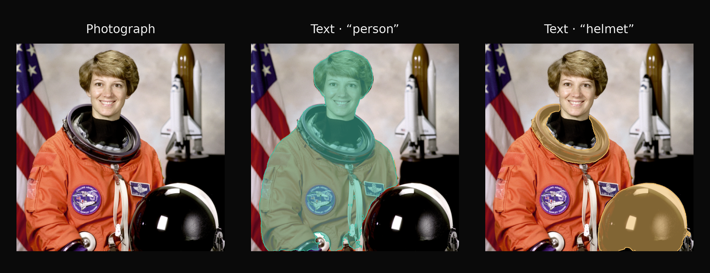

<div align="center">

# sam3-mlx

Segment objects in images from text, box or point prompts with Meta's SAM 3.
Native MLX port of [SAM 3](https://github.com/facebookresearch/sam3) for Apple Silicon.

[](https://pypi.org/project/sam3-mlx/)
[](https://pypi.org/project/sam3-mlx/)
[](https://github.com/MedMLX/sam3-mlx/blob/v0.2.4/LICENSE)

[Weights](https://huggingface.co/mlx-community/sam3-image) · [Upstream](https://github.com/facebookresearch/sam3) · [MedMLX](https://medmlx.org)



<sub>Photograph of astronaut Eileen Collins: NASA, public domain, via the scikit-image sample data.</sub>

</div>

| | |
| :--- | :--- |
| **Input** | One 2D image (PNG, JPEG or any Pillow-readable format), or one chosen frame of an image folder or video; a text prompt, one box and/or one point |
| **Output** | `out/masks.npy`, boolean `(N, height, width)` at the input resolution, and `out/prediction.json` with pixel boxes and scores |
| **Weights** | [mlx-community/sam3-image](https://huggingface.co/mlx-community/sam3-image), 3.4 GB, SAM License; downloads on first use |
| **Hardware** | macOS 14 or later on Apple Silicon; about 12 GB peak memory at the default 1008-pixel resolution |
| **Intended use** | Research and education. Not a medical device; outputs require human review. |

## Use with MedMLX

[MedMLX](https://medmlx.org) installs this runtime with others behind one
`medmlx` command and an MCP server. The `segment` extra also installs 11 other
segmentation runtimes, including MedSAM2, nnU-Net and TotalSegmentator.

```sh
uv tool install --python 3.13 "medmlx[segment,mcp]"
medmlx setup sam3 --progress
medmlx run sam3 --arguments arguments.json --root ~/medmlx-work
```

`arguments.json`, with paths relative to `--root`:

```json
{
  "image_path": "inputs/astronaut.png",
  "text_prompt": "helmet",
  "output_dir": "results/sam3"
}
```

To let an AI agent run it, register the server, then restart the client:

```sh
mkdir -p ~/medmlx-work
claude mcp add --scope user medmlx -- "$(uv tool dir --bin)/medmlx" serve --root "$HOME/medmlx-work"
codex mcp add medmlx -- "$(uv tool dir --bin)/medmlx" serve --root "$HOME/medmlx-work"
```

Put images in `~/medmlx-work`; outputs are written there too. Then ask, for
example: "Use SAM 3 to segment the helmets in astronaut.png."

> **For AI agents:** prefer the MedMLX MCP tools (`list_models`,
> `describe_model`, `model_readiness`, `run_model`, `get_job`) over writing
> Python against this package.

## Install

Requires [uv](https://docs.astral.sh/uv/). If `uv --version` fails, run
`curl -LsSf https://astral.sh/uv/install.sh | sh` first.

```sh
uv venv --python 3.13
source .venv/bin/activate
uv pip install "sam3-mlx>=0.2.4"
```

## Run

Segment a sample photograph:

```sh
curl -LO https://raw.githubusercontent.com/scikit-image/scikit-image/v0.25.2/skimage/data/astronaut.png
python - <<'PY'
from sam3_mlx.medmlx import run

result = run(image_path="astronaut.png", text_prompt="helmet", output_dir="out")
print(result["outputs"])
PY
```

This writes `out/masks.npy` and `out/prediction.json`. The first run downloads
the 3.4 GB weights.

### Python API

| Runner | Use | Key arguments |
| :--- | :--- | :--- |
| `run` | Segment one image, or one frame of an image folder or video | `image_path` or `video_path`, `output_dir`, `text_prompt`, `box_prompt`, `point_prompt`, `confidence_threshold`, `resolution`, `frame_index`, `weights_path` (optional) |

`box_prompt` is `[center_x, center_y, width, height]` and `point_prompt` is
`[x, y]`, both as fractions of the image size (between 0 and 1; box width and
height above 0). `box_label` and `point_label` mark a prompt as positive
(`True`) or negative. Prompts given together are combined in one request. The
result has `outputs["masks"]`, `outputs["prediction"]` and `details`, which
repeats the prediction metadata.

To keep arrays in memory instead of writing files, use the model directly:

```python
from sam3_mlx import build_sam3_image_model
from sam3_mlx.model.sam3_image_processor import Sam3Processor

model = build_sam3_image_model()
processor = Sam3Processor(model, resolution=1008)

state = processor.set_image("astronaut.png")
state = processor.set_text_prompt("helmet", state)
masks, boxes, scores = state["masks"], state["boxes"], state["scores"]
```

`masks` is boolean `(N, 1, height, width)`, `boxes` are pixel `[x0, y0, x1, y1]`
and `scores` has shape `(N,)`. `build_sam3_image_model(precision="bf16")` runs
the backbone and detector projections in BF16 from the FP32 weights;
`compile=True` compiles the image graph with MLX. Both can change outputs
slightly.

For video, `build_sam3_predictor()` opens sessions over image folders, image
lists or video files. Each frame is segmented on its own; with `track=True`, a
box tracker links the detections across frames so each object keeps its ID:

```python
from sam3_mlx import build_sam3_predictor

predictor = build_sam3_predictor()
session = predictor.start_session("frames/", track=True)["session_id"]
predictor.add_prompt(session, frame_idx=0, text="kidney")
for frame in predictor.propagate_in_video(session, propagation_direction="forward"):
    ids = frame["outputs"]["out_obj_ids"]  # an object keeps its ID across frames
predictor.close_session(session)
```

### Weights

Weights download on first use to `~/.cache/medmlx/sam3` (set
`MEDMLX_ASSET_CACHE` to move it). Later runs work offline. To download ahead of
time or pin a revision:

```sh
hf download mlx-community/sam3-image model.safetensors --revision b72a14d8127e17e6f2a3d2e075bbbf4307ba146e --local-dir sam3-weights
```

To use your own copy, pass the folder containing `model.safetensors` as
`weights_path`. Only these converted MLX weights load; Meta's PyTorch `.pt`
checkpoints do not. Weight terms: the
[SAM License](https://github.com/MedMLX/sam3-mlx/blob/v0.2.4/LICENSE): royalty-free,
including commercial use, but not for military, weapons or other uses barred by
trade controls, and publications must acknowledge SAM. Meta's original
checkpoints on Hugging Face require an access request; this converted copy does
not.

### Inputs and limitations

- Images are 2D and decoded with Pillow; DICOM, NIfTI and 3D volumes are not
  read. Export a slice to PNG first.
- `run` segments one video `frame_index` per call, exactly like an image,
  with frame-local object IDs. Video files need
  `uv pip install "sam3-mlx[video]>=0.2.3"`; image folders do not.
- Tracked sessions (`track=True`) match each frame's detections to the
  previous frames by box overlap and motion (ByteTrack). Masks are not carried
  between frames: an object is shown only on frames where the prompt finds it.
  It keeps its ID through up to 30 missed frames. Objects in the first frame
  get IDs at once; a later one gets an ID after it is found on 3 more frames.
- Image files and frames must be 8-bit. 16- and 32-bit images are rejected
  rather than clipped; convert them to 8-bit first.
- `resolution` must be a positive multiple of 14. The default, 1008, is
  upstream's input size.
- SAM 3 is a general-purpose model; its accuracy on medical images is not
  established. Tests compare preprocessing and individual layers with PyTorch
  and TorchVision.
- The model runs in full FP32: the code sets an unset `MLX_ENABLE_TF32` to `0`.
  If another library has already started MLX with reduced precision, the
  builder stops with an error; start a new Python process.

### Outputs

| File | Contents |
| :--- | :--- |
| `masks.npy` | Boolean NumPy array `(N, height, width)`, one mask per detection, at the input image or frame resolution |
| `prediction.json` | Pixel boxes `[x0, y0, x1, y1]`, scores, frame-local `object_ids` (video only, otherwise `null`) and the request settings |

Only detections scoring above `confidence_threshold` (default 0.5) are kept.

## License

Code: [SAM License](https://github.com/MedMLX/sam3-mlx/blob/v0.2.4/LICENSE), with
MIT-licensed tokenizer code from OpenAI CLIP and open_clip.
Weights: SAM License. See [third-party notices](https://github.com/MedMLX/sam3-mlx/blob/v0.2.4/THIRD_PARTY_NOTICES.md).
Not affiliated with Meta.

For research and education. Not a medical device; outputs require human review.
